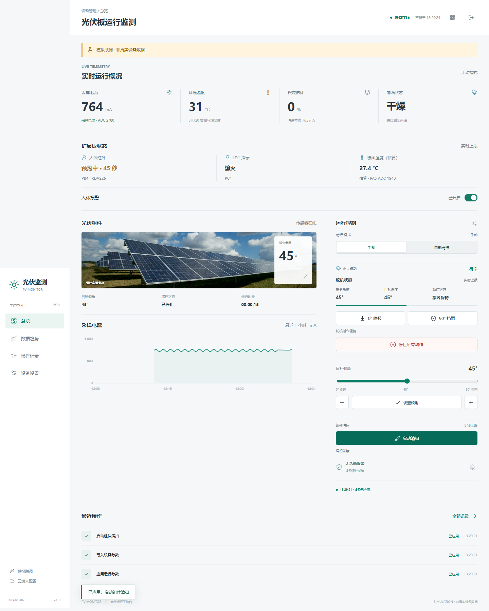
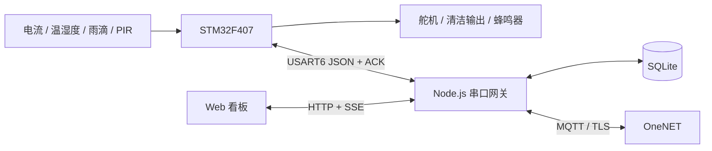

# 光伏板积灰与发电状态监测系统

基于 STM32F407 的光伏监测与清洁控制项目，包含 HAL 固件、串口网关、Web 看板和 OneNET 接入。由 `flxd123212` 个人独立设计与实现；使用的芯片库与软件依赖保留各自许可。

项目覆盖从传感器采集到远程控制回执的完整链路，重点是异常情况下的控制边界，而不只是显示实时数值。



上图来自浏览器自动化测试，使用模拟数据展示界面，不是实机测量记录。

## 项目亮点

| 能力 | 实现方式 |
| --- | --- |
| 多源采集 | ADC 电流、SHT20 温湿度、NTC 温度估算、雨滴与人体活动输入 |
| 控制闭环 | 串口 JSON 协议、cmdId、ACK 超时重试、重复命令处理 |
| 安全联锁 | 雨滴、状态失效与离线判断，清洁控制限制，STOP 锁定后显式恢复 |
| 断电恢复 | Flash 双扇区日志、序号、CRC 与提交标记，上电保持电机关闭 |
| 数据展示 | Node.js 网关、SQLite、SSE 实时数据、曲线与 CSV 导出 |
| 云端接入 | OneNET MQTT/TLS，凭据从本地环境变量读取 |
| 可验证性 | 固件主机测试、Node 测试、浏览器测试及传感器审计文档 |



## 硬件与接口

| 功能 | 接口 | 说明 |
| --- | --- | --- |
| 电流采集 | PB0 / ADC | 0.1 Ω 分流电阻、放大增益 101，需按实际电路校准 |
| 温湿度 | PB6 / PB7 | SHT20 I2C，包含 CRC 和超时处理 |
| 温度估算 | PA5 / ADC | NTC AO，B3950 典型模型，未经标定不能当作精密测温 |
| 雨滴 | PA4 | 低电平有效，失效或状态过期时限制清洁动作 |
| 人体活动 | PB4 | PIR 预热与活动保持，不代表静止人员存在检测 |
| 舵机 | PC8 / TIM3_CH3 | 20 ms PWM 周期，收纳/避雨角度控制 |
| 清洁 / 报警 | PC6 / PA15 | 清洁输出与蜂鸣器 |
| 上位机通信 | PG14 TX / PG9 RX | USART6，115200、8N1 |

请以 `pv_ui.ioc`、原理图和所用开发板实际引脚为准。PC8 与部分开发板 KEY2 复用，接线前应检查冲突。PB1 电位器是调试输入，不是温度传感器。

## 工程结构

```text
Core/                 STM32 应用、传感器驱动与存储逻辑
Drivers/              STM32 HAL / CMSIS，保留原许可
MDK-ARM/              Keil 工程、启动代码与链接配置
pv_ui.ioc             STM32CubeMX 配置
platform/server/      串口、协议、存储、HTTP、OneNET 网关
platform/web/         Web 看板
platform/test/        Node.js 自动化测试
platform/browser-test/ Playwright 看板测试
tests/                固件主机测试与 mock
tools/                本地启动与固件测试脚本
docs/                 协议、接线审计、传感器与云端说明
deploy/               容器部署示例
```

## 运行与复现

### 固件

使用 STM32CubeMX 检查 `pv_ui.ioc`，在 Keil 中打开 `MDK-ARM/pv_ui.uvprojx`。按实际电路配置电流校准参数，确认电源、引脚与电平后编译烧录。先不连接电机负载，逐项检查传感器与输出，再进行联调。

### 网关与看板

需要 Node.js 22.13 或更新的兼容版本，以及可访问开发板串口的电脑。STM32 通过串口连接网关，本项目并非单片机直接运行网页服务或独立 Wi-Fi 上云。

```powershell
cd platform
npm ci
Copy-Item .env.example .env
# 根据本机串口及云端配置编辑 .env
npm run build
npm start
```

环境变量、串口选择和运行入口见 [操作说明](docs/OPERATING_GUIDE.md)；云端配置见 [OneNET 接入](docs/onenet.md)。实际密钥仅保存在本地 `.env`，不要提交到 GitHub。

### 软件验证

```powershell
# 项目根目录：需要 MSVC 与 Windows SDK，运行固件主机测试
powershell -ExecutionPolicy Bypass -File tools/test-firmware.ps1

cd platform
npm test
npm run build
# 安装对应 Playwright 浏览器后可运行
npm run test:browser
```

主机 mock 与自动化测试验证协议、状态逻辑和接口行为，不能代替实机传感器精度、Flash 耐久或电机安全验收。原说明中的历史测试记录不代表每个新环境均已重新验证。

本次发布已重新运行三组固件主机测试、36 项 Node 测试、9 项浏览器测试及前端构建，详见 [发布验证记录](docs/VALIDATION.md)。

## 指标与安全边界

- 本项目以参考电流对比估算相对损失，不能测出积灰厚度，也不能独立区分云影、遮挡与积灰；未配套辐照度等测量时，不宣称精确转换效率。
- NTC 使用典型参数估温；舵机显示的是控制目标角度，并非编码器测得的实际位置。
- PIR 只提供活动信号；雨滴数字输入不具备独立断线诊断能力。
- STOP 是软件联锁，不是经过安全认证的硬件急停。实物演示需保留独立断电手段。
- 发布版本不包含个人身份材料、真实账号密钥、运行数据库与编译产物。

## 作者与第三方代码

项目设计与实现：`flxd123212`。ST HAL / CMSIS 及 npm 依赖属于各自作者，使用时遵守相关目录中的许可。本仓库不把第三方库宣称为个人原创。
